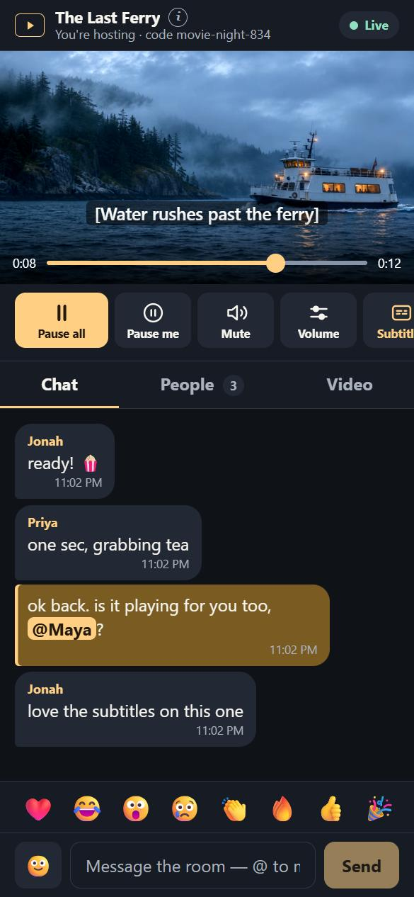
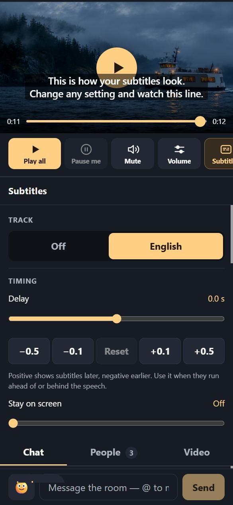
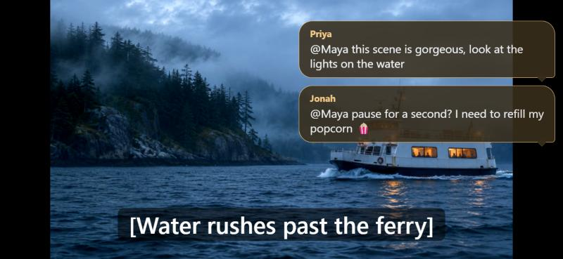
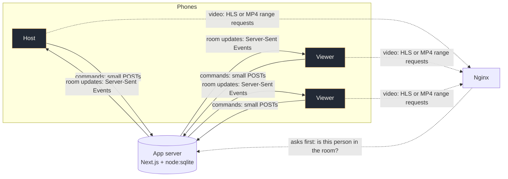

<div align="center">

# 🎬 Screening Room

**Watch a video together, in perfect step, from your phones.**

A private, self-hosted watch party. Everyone's picture stays in sync, with chat, @-mentions, scrolling emoji reactions,
subtitles you can restyle live, and a layout built for a phone held in one hand.

[](https://nodejs.org)
[](https://nextjs.org)
[](tsconfig.json)
[](https://nodejs.org/api/sqlite.html)
[](#languages)

### [▶ Try the interactive demo](https://monstercameron.github.io/synchronized-video-streaming/) · [Run it yourself](#quick-start) · [Deploy it](deploy/DOCKER.md)

<br>


&nbsp;

&nbsp;


<sub>Screenshots use the small generated sample video that ships with the project.</sub>

</div>

---

## Why this exists

Most "watch together" tools want an account, a subscription, or someone else's server. This one is a single Node process
and a folder of videos that you run yourself. Share a room code, and everyone who joins sees the same frame at the same
moment, on whatever phone they have, including old ones on slow connections.

## What you get

**Staying in sync**
- One shared clock for the room. A play is scheduled a fraction of a second ahead so every device starts together;
  small drift is corrected by nudging the playback speed, large drift by a quick jump.
- **Anyone can pause; only the host can play or seek**, so one person's tap can't shove the film for everyone.
  A viewer who can't start the video taps **Waiting** to send the host a "Play now" prompt.
- **Pause me / Rejoin**: stop only your own screen (a phone call, a snack), then jump back to where the room is.
- A device that restarts or reconnects jumps straight to the room's position, and learns how long a seek takes on that device.
- Stalls are handled gracefully: a spinner, automatic retries when the connection drops, and the room is told when
  someone is buffering ([details](#buffering-and-seeking)).

**Being together**
- Chat with **@-mentions** (highlighted for the person mentioned), **@everyone**, and a reaction bar whose emoji scroll
  across the picture for everybody.
- In full screen (or a phone held sideways) incoming chat appears as **speech bubbles**; tap one to reply with the keyboard up.
- Custom **room codes** that your friends can actually type, or random private links.

**Subtitles done properly**
- Open the Subtitles panel to pick a track in one tap, then adjust **delay, how long lines stay, how many stack, size,
  position, colour, opacity, outline, shadow and font** with live preview. Each person keeps their own look.
- SRT and VTT upload by the host; Windows-1252 files are converted to UTF-8.

**Made for phones**
- Mobile-first layout, full-screen rotation, a volume row, a scrolling control row, and keyboard-aware layout so the message
  box is never hidden behind the on-screen keyboard.
- **Low-end phone mode**: lighter effects, fewer timers, Data saver quality, and automatic detection of a slow device.
- **Per-person quality** for adaptive (HLS) videos: Auto, Data saver, or a fixed rung, independent of everyone else.

**Running it**
- **Media library** with uploads, a **storage cap (4 GB by default)** with a usage bar, and delete to free space.
- A **prepare script** that turns almost any file into a browser-ready MP4 or an adaptive HLS ladder with subtitles and a poster.
- Optional **web lookup of a video's details** (title, synopsis, cast) through a model you configure; off unless you set a key.
- **English and Spanish**, chosen on the first visit.
- A **Docker image** built and published by GitHub Actions, a compose file with Nginx (HTTPS, HTTP/2, HTTP/3), and plain systemd and kernel-tuning files, plus measured performance notes.

## Quick start

You need **Node.js 24 or newer** (the app uses the built-in `node:sqlite`) and, for scanning and preparing videos,
[FFmpeg](https://ffmpeg.org) on your PATH.

```bash
git clone https://github.com/monstercameron/synchronized-video-streaming.git
cd synchronized-video-streaming
npm install
npm run media:sample        # installs the small demo video into .data/media
npm run build
npm run start -- --hostname 0.0.0.0 --port 3000
```

Prefer containers? See [Docker on a droplet](deploy/DOCKER.md).

Open `http://<your computer's address>:3000` on your phone (same Wi-Fi), pick a language, start a room, and send the code to
a friend. Drop your own videos into `.data/media` (or upload them as host) and tap **Rescan** in the Video tab.

Make a file browser-ready (copies video and audio when it can, converts only what it must):

```bash
npm run media:prepare -- "My Movie.mkv"                              # a fast-start MP4 with subtitles and a poster
npm run media:prepare -- "My Movie.mkv" --hls --audio-lang eng       # an adaptive ladder (up to 1080p / 720p / 480p / 360p / 240p, depending on the source height)
```

## How it works



- **Live updates over one open response per viewer** (Server-Sent Events) and tiny POSTs for commands. They share the same
  HTTP/2 or HTTP/3 connection as the page and the video, so there is no second connection to set up (a WebSocket would need
  one). After connecting, each update carries only what changed: about 120 bytes for a play or pause, against about 1 KB for
  the whole room.
- **The server works out a room's state once per change**, not once per viewer, and sends the same prepared message to
  everyone who is in step. Only someone with something of their own to show (such as asking the host to play) gets an
  individual message.
- **Video bytes never go through the app in production.** The app only checks that you are in the room and that this is the
  room's current video, then tells Nginx to send the file straight from disk (`X-Accel-Redirect`). Nginx also handles seeking.
- **The playback clock.** Each device measures its offset from the server's clock (best of a few round trips, refreshed every
  minute). A play is anchored 550 ms in the future so everyone starts together. While playing, a device that is off by more
  than 0.18 s nudges its playback speed to 0.94x or 1.06x; more than 0.55 s off (0.12 s right after a play, pause or seek), it jumps. A jump aims slightly ahead by
  the time seeks have recently taken on that device.

Everything is a single process with an embedded database, which keeps a small droplet comfortable. The measured numbers
are in [Performance notes](#performance-notes).

## Configuration

Settings are environment variables (see [`deploy/screening.env.example`](deploy/screening.env.example)).

| Variable | Default | What it does |
| --- | --- | --- |
| `MEDIA_DIR` | `.data/media` | Where videos, subtitles and posters live |
| `SCREENING_DB_PATH` | `.data/screening.sqlite` | The SQLite database |
| `MEDIA_ACCEL_PREFIX` | *(unset)* | Hand video bytes to Nginx (`/_media`) after the app has checked access. Unset, the app streams files itself |
| `MEDIA_QUOTA_GB` | `4` | Cap on the whole media folder. Uploads that would pass it are refused |
| `MAX_UPLOAD_GB` | `20` (example file: `4`) | Largest single upload |
| `COMPRESS` | on | Set `off` behind Nginx so Node does not compress a second time |
| `FFPROBE_PATH` | `ffprobe` | If ffprobe is not on the PATH |
| `METADATA_API_KEY` | *(unset)* | Turns on the host's **Find details** button. Nothing is sent without it |
| `METADATA_MODEL` / `METADATA_API_BASE` | `gpt-6-luna` / `https://api.openai.com/v1` | The model and an OpenAI-compatible Responses API endpoint with web search |

> **About the lookup model:** the default model name is a placeholder taken from the original request and has not been
> verified against any provider. Set `METADATA_MODEL` to a model your provider offers.

## Project layout

| Path | What is in it |
| --- | --- |
| `app/` | The Next.js app: pages and API routes (`app/api/rooms/…`), the player and room UI, and the server logic |
| `app/room-store.ts` | Rooms, commands, shared state, who is connected, housekeeping |
| `app/use-room-playback.ts` | The sync loop on each device |
| `app/api/rooms/[roomId]/events/route.ts` | The live event stream |
| `app/media-*.ts` | Library scan, catalog, serving files with Range support, storage quota, web lookup |
| `app/i18n/` | English and Spanish texts (`en.ts` is the list of keys; the compiler checks `es.ts` matches) |
| `Dockerfile`, `compose.yaml`, `.github/workflows/` | The container image, the droplet compose file, and the workflow that builds and publishes the image |
| `deploy/` | Docker and non-Docker deployment guides (`DOCKER.md`, `README.md`), Nginx, systemd, kernel and environment files |
| `scripts/` | Make a video browser-ready, check the language files, install the sample, load test |
| `samples/` | A tiny generated demo video (adaptive, with subtitles) |
| `docs/` | The GitHub Pages site (interactive demo and explainer) and README screenshots |

Developer commands: `npm run typecheck`, `npm run i18n:check`, `npm run load:test`, `npm run media:prepare`, `npm run media:sample`.

## Languages

English and Spanish. A first-time visitor is asked which to use before anything else; the choice is kept in a cookie so
the server renders it straight away next time, and it can be changed at any time from the join screen, the video details,
or Settings. Server errors are sent as message codes and translated on the phone, and subtitle language names, dates,
times and numbers (decimal comma in Spanish) come from the browser's own locale data. `npm run i18n:check` verifies the two
language files match. The Spanish was written without a native-speaker review.

## Privacy and security

- Rooms are private: you need the code or link, and every request (video, subtitles, updates) is checked against room
  membership. A room that doesn't exist and a room you haven't joined look identical from outside.
- At most 10 wrong room codes per minute per address; commands must come from the app's own origin; the session cookie is
  `HttpOnly`; a room holds at most 50 people; reactions are limited to 6 per 2 seconds per person.
- Only the host can upload, delete, choose the video or look up details. Uploads stream to disk and respect the storage cap.
- No analytics and no third-party scripts. The running app makes no outbound requests except the optional **Find details**
  lookup, and it sends the video's file name, title, length and picture size (plus any hint the host types) when the host taps the button. (Next.js's own build tooling sends anonymous telemetry unless you set `NEXT_TELEMETRY_DISABLED=1`; the Docker image sets it.)
- **Not designed for hostile networks.** It is a small private service for friends: there are no accounts, and anyone who has
  a room's code can join it. Put it behind HTTPS (see the deployment guide) and treat codes like passwords.

## Honest limits

- Tested in a browser emulator at phone and tablet sizes and under simulated network trouble, **not on a range of real
  phones**. Fullscreen rotation, the on-screen keyboard and Safari's built-in HLS player are the least-verified parts.
- The deploy files and the Docker image have **never been run on a real droplet**, and the image has not been built locally. Treat the first deploy as a dry run.
- Performance figures come from one laptop; see the caveats in [Performance notes](#performance-notes).
- Released under the [MIT License](LICENSE). The sample video in `samples/` is generated for this project.

---

## Performance notes

These are measurements, not promises. They were taken on one Windows 11 ARM64 laptop with the load generator running on the
same machine, so absolute numbers on a droplet will differ and the CPU figures carry about ±0.5 s of run-to-run noise.
Compare the numbers to each other, not to a server.

### The load test

`npm run load:test -- <port> <seconds> [rooms] [viewers per room]` (the file is `scripts/load-test.mjs`).
Used here: **5 rooms × 20 viewers = 100 live connections for 25 seconds**. In that time the hosts play and pause every
second, viewers chat about once a second and react about five times a second per room, and about 30 video range requests a
second are made. That is roughly **17,000 events delivered, 840 commands and 690 media requests**, far busier than a real
watch party. Server CPU is the process's CPU seconds during the run; memory is its working set.

### Server CPU and memory

| Version | CPU seconds (25 s run) | Peak memory |
| --- | --- | --- |
| Before this work | 6.61 | 186 MB |
| After the code changes | 5.61 | 187 MB |
| + `--max-old-space-size=160 --max-semi-space-size=2` | 5.86 (a second run: 6.92) | 117 MB (a second run: 109 MB) |
| + `--max-semi-space-size=1` | 6.23 | 114 MB |
| + `--max-old-space-size=128 --max-semi-space-size=1` | 6.31 | 114 MB |

**Reading it:** the code changes took about 15% off the CPU (a bit more than the noise). The memory flags took about 38% off
the peak for roughly 5 to 10% more CPU, because a small young generation makes the garbage collector run more often. The
deployed service uses the 160 MB / 2 MB combination.

**Where the CPU goes now.** A CPU profile of the optimised server under the same load showed the app's own code at only
**1.3%** of the busy time. The rest is Next.js's per-request machinery and writing to sockets. So further gains come from
doing less work *in Node* (static files, compression, video bytes), not from tuning the app code.

#### What was changed for CPU

- **Shared work per event.** A play, pause or new member used to be worked out separately for every viewer (several database
  queries and hashing each time). It is now worked out once per change (`sharedState` in `app/room-store.ts`). The parts of
  it that did not change are the very same objects as last time, so comparing two states is a few reference checks.
- **Update messages made once.** The "what changed" message for viewers who are in step is built once and handed to all of
  them (cached on the state it follows). Chat and reaction messages are turned into bytes once, not once per viewer.
  Only a viewer with something of their own to show (someone asking the host to play) gets an individual message.
- **Prepared statements are kept.** SQLite compiles a statement far slower than it runs it, and the same few statements
  ran on every request. `app/db.ts` keeps the compiled ones.
- **No disk flush after every write.** `PRAGMA synchronous = NORMAL` (safe in WAL mode; at worst the last moments before a
  power cut are lost) instead of a flush for every chat message and playback command.
- **Things read on every request are kept in memory** and dropped at exactly the moments they can change: the room's row,
  its member list, which member a session belongs to, the video catalog and what is derived from it, and the real path of
  the media folder. This matters most for HLS, where every segment request is checked.
- **One keep-alive timer** for all open streams instead of one per viewer.
- **Nginx does what it is better at** (see `deploy/`): it serves the app's JavaScript and CSS straight from disk with a year's
  caching, compresses responses (so `COMPRESS=off` stops Node doing it a second time), and sends the video bytes.

#### What was changed for memory

- **Nothing in memory grows without limit.** A sweeper (once a minute, `sweep` in `app/room-store.ts`) forgets reaction
  rate counters, "asked to play" requests and pauses for rooms nobody is connected to, and what a person reported about
  their device ten minutes after they leave. The caches above have size limits as a safety net.
- **Node flags and service limits** in `deploy/screening.service`: `--max-old-space-size=160 --max-semi-space-size=2`, and
  systemd `MemoryHigh=320M` / `MemoryMax=420M` so a fault cannot take the whole droplet.
- **No per-viewer copy of the room.** Each connection remembers only a reference to the last shared state it sent.

### Bun: runtime, `--compile` and AOT bytecode

The question was whether running the server on [Bun](https://bun.sh) would help, either as the runtime or as a compiled
single-file executable, with or without ahead-of-time bytecode (`--bytecode`). Bun 1.4.4 (native Windows ARM64, a portable
download that was deleted afterwards) was tried against the same standalone build of the app under Node 26.

#### Bun as the runtime: it works, with trade-offs

Built with the opt-in standalone output (`NEXT_STANDALONE=1 NEXT_DIST_DIR=.next-standalone npm run build`, then the
static files copied in) and started with `bun server.js` instead of `node server.js`. `node:sqlite`, the live event streams,
the command routes and the media routes all ran; the load test completed with no errors and the same number of events.
Uploads, the library scan's `ffprobe` spawning and long-running connection drops were **not** exercised.

| | Node 26 | Bun 1.4.4 |
| --- | --- | --- |
| Time until the port accepts connections (median of 5 starts) | 296 ms | 202 ms |
| Time until the home page is served (median of 5) | 474 ms | 403 ms |
| CPU seconds in the 25 s load test (two runs) | 5.81 and 6.25 | 6.58 and 6.14 |
| Peak memory in the load test (two runs) | 183 and 167 MB | 140 and 134 MB |

**Reading it:** Bun starts about 30% faster and uses about 20% less memory out of the box, with CPU that is the same within
the noise (about 5% higher on average). But plain Node with the memory flags above reaches 109 to 117 MB, which is below
Bun's 134 to 140 MB, so Bun's memory advantage disappears once Node is tuned.

(An earlier start-up reading of 4 seconds for Node and 121 seconds for Bun was a measurement artifact of launching a program
for the first time on this machine, not the app. It did not repeat in five timed starts.)

#### `bun build --compile`: could not be made to work

Compiling means embedding the program in one executable. It failed in four ways, in order:

1. **Plain compile** of the standalone `server.js`: the bundler cannot resolve `./dev/next-dev-server`,
   `./router-utils/setup-dev-bundler`, `../../lib/upgrade/nudge` and `@opentelemetry/api`. Next's standalone output leaves
   out its development files on purpose, and the bundler follows every `require` whether it is used or not.
2. **With those four stubbed** (they are dev-only or optional): it then cannot resolve `react-dom/server*` and
   `react-server-dom-webpack/client`, which Next maps to its own bundled copies by a build-time alias that Bun's bundler does
   not apply.
3. **With `--packages external`** (embed only the entry file and load `next` from disk): this does compile, to a
   **95.6 MB** executable, and **95.9 MB** with `--bytecode`, but the executable cannot start:
   `Cannot find package 'next' from 'B:\~BUN\root\screening-compiled.exe'`. It looks for packages relative to its own
   embedded root, not the folder it sits in, and setting `NODE_PATH` did not change that.
4. **Bundling from the project root** (so the full `node_modules` is available) failed on the same `react-dom/server`.

So there is **no working compiled build, and therefore no benchmark of one**. For the AOT case there is also nothing to
gain even if it ran: in the only variant that compiles, `--bytecode` precompiles just the tiny entry file, and all of
Next.js's own code is still loaded from disk, so start-up would be unchanged. (Both sizes are almost entirely the embedded
Bun runtime.) Next.js is simply not built to be bundled into a single file; the supported ways to get a small self-contained
deploy are the `standalone` output and, if wanted, a container.

#### Recommendation

**Stay on Node 24+ for the droplet.** It is the runtime Next.js 16 supports, it needs `node:sqlite` (which Bun happens to
provide, but that is a moving target), and tuned Node already uses less memory than Bun. Bun is a reasonable thing to try if
start-up time ever matters (`bun server.js` from the standalone build); if you do, re-run `npm run load:test`, and also test
what the load test does not cover (large uploads, many dropped connections, `ffprobe` spawning) before relying on it.

### Re-running the numbers

```bash
# a test server with its own database and a small media folder
SCREENING_DB_PATH=/tmp/load.sqlite MEDIA_DIR=/tmp/loadmedia PORT=3200 node node_modules/next/dist/bin/next start
# in another terminal, while watching that process's CPU time and memory
npm run load:test -- 3200 25 5 20
```

The opt-in standalone build (`NEXT_STANDALONE=1 NEXT_DIST_DIR=.next-standalone npm run build`) writes to its own folder and
does not touch the normal `.next` build.

---

## Buffering and seeking

Video that stalls or jumps is the most common thing to go wrong in a watch party, so the player says what is happening and
recovers by itself instead of failing.

### What the viewer sees

- **A spinner over the picture** while the video waits for data: "Jumping…" after a seek, "Buffering…" when it runs out of
  data while playing. It appears only if the wait lasts about a third of a second, so quick seeks do not flash one, and it
  goes away a moment after the picture is back, so a stall that restarts straight away does not blink. After about three
  seconds it adds "This is taking a while. Check your connection." The big play button steps aside while the spinner shows.
- **A lighter bar on the timeline** showing how far the video has loaded ahead of the playing position, so a seek can be
  aimed at what will start at once.
- **"Connection to the video lost. Trying again…"** while a dropped connection is being retried, and "You're offline…" if the
  browser reports no network. A failure screen appears only after several retries have failed.

### What the room sees

After a device has been waiting for data for **3 seconds**, it tells the room. The People tab shows a "Buffering" tag next to
that person, and everyone else's picture shows "Ann is buffering…" while the room is playing. It clears itself when the person
catches up, when they disconnect, or when a different video is loaded. Short waits are not reported. Nothing pauses the room:
the person who fell behind jumps forward to the room's position once data arrives (the lead time learned from earlier jumps
makes that land close). Pausing the room for slow viewers could be added later as a host option.

### How recovery works

- **Streaming (HLS) video:** a fatal network error is retried by restarting the download after 0.8, 1.6, 3.2, 6.4 and 8 seconds;
  a decoding error resets the decoder (the second time also trying the other audio path). Getting data again resets the
  counters. Coming back online restarts the download straight away.
- **Single-file (MP4) video:** a network error reloads the file and resumes from the same spot, with the same growing pauses.
  Anything that is not a network error shows the normal error with a "Try again" button.
- **The sync loop no longer fights a slow jump.** The room keeps moving while the data for a jump is arriving, so the gap
  grows and every check used to say "jump again", cancelling the download the last jump started, over and over on a slow
  connection. While waiting for the first frames after a jump, the loop now lets it finish (for up to 5 seconds); one more
  jump when the data arrives corrects what is left.

### What was tested

With a small proxy in front of the app that could throttle or cut the video connection on demand, on a desktop browser at
320 px and 667 px wide, in English and Spanish:

- A link slower than the video: "Jumping…" then "Buffering…" appeared and cleared as data arrived, and the room was told
  (and told again when it recovered).
- The connection cut mid-download: the browser resumed on its own with no error screen.
- The network down while seeking, for 11 seconds (MP4) and 16 seconds (HLS): "Jumping…" the whole time, no error screen, and
  playback resumed in step with the room (about 1 second after the network returned for MP4, about 7 seconds for HLS because
  hls.js backs off its retries).
- Another viewer reporting buffering: the notice and the People tag appeared and cleared.
- The layout checks (no overflow, nothing clipped, spinner inside the picture) and the server behaviour tests.

### What was not tested

- **Real phones.** Real networks (walking between Wi-Fi and mobile data) behave differently from a proxy that drops a socket.
- **Long outages.** Outages beyond about 20 seconds, where the retries run out and the error screen is supposed to appear.
- **Safari's built-in HLS player**, which does not go through hls.js (it gets the spinner and the room report, but not the
  hls.js retry logic).
- **Big rooms.** The room is told when someone buffers, but the load test was not run with many people buffering at once.
