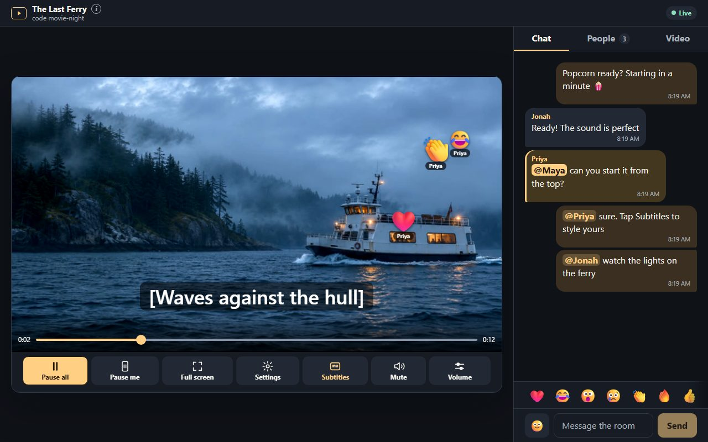
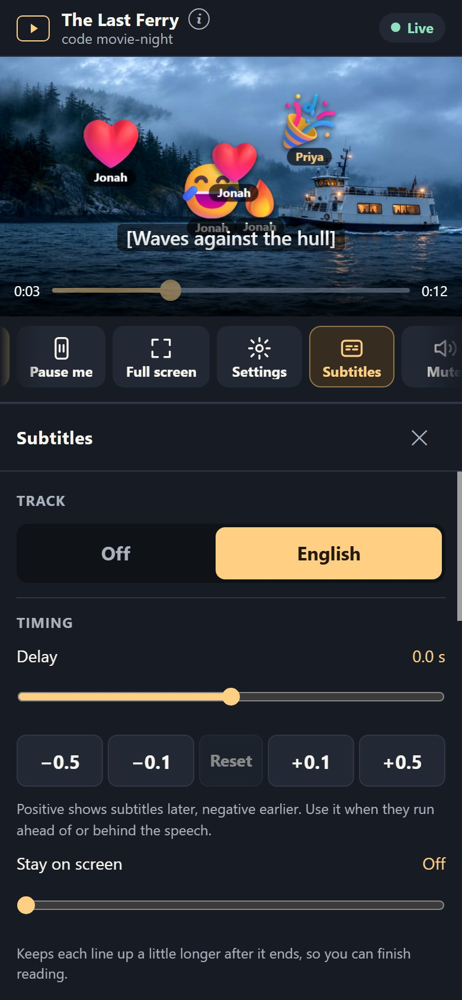
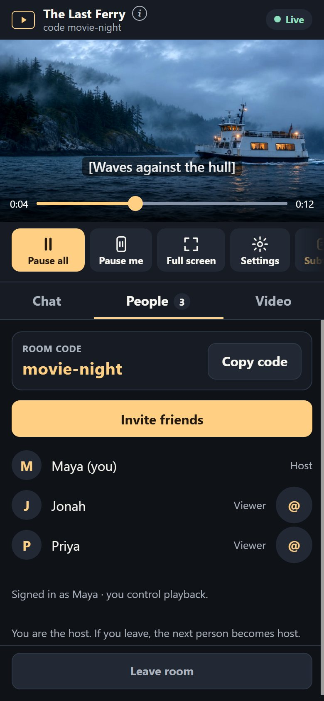
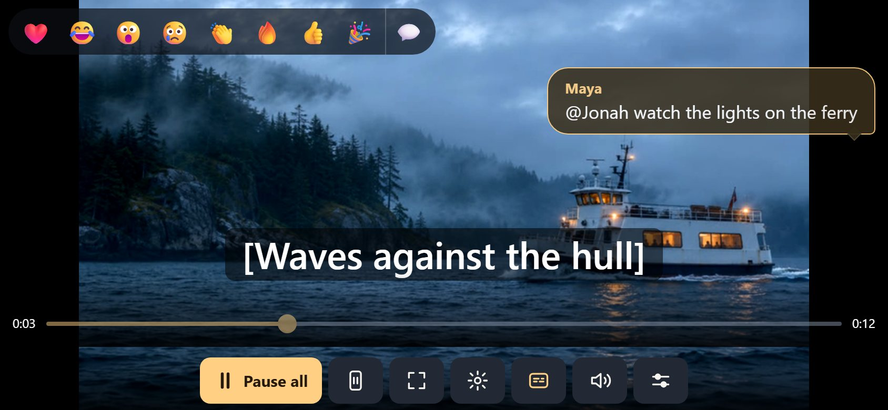
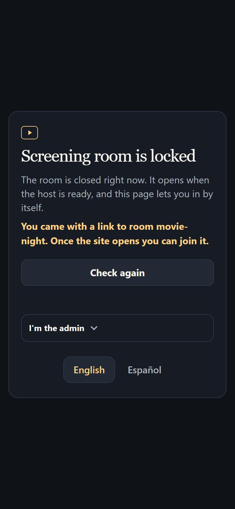
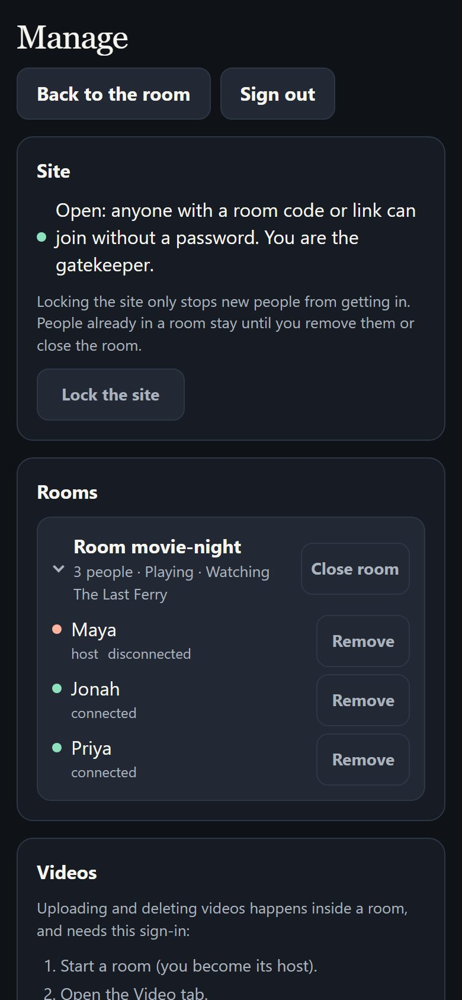
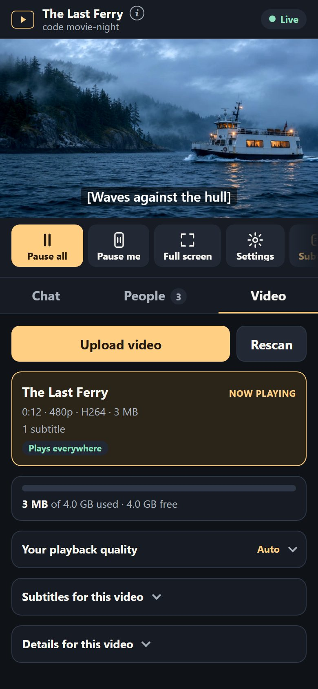
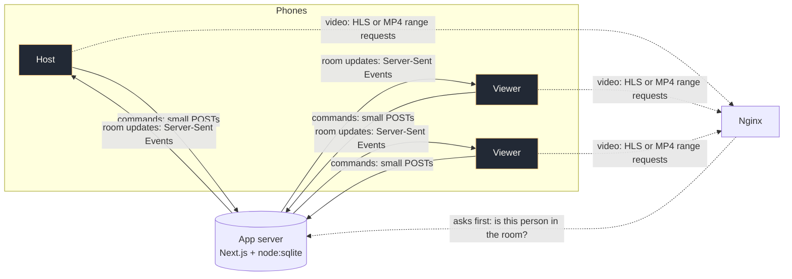

<div align="center">

# Screening Room

**Watch a video together, in sync, from your phones.**

A self-hosted watch party: one small server, a folder of videos and a room code.<br>
Everyone sees the same frame at the same moment, with chat, reactions and subtitles each person can style.

[](https://github.com/monstercameron/synchronized-video-streaming/actions/workflows/docker.yml)
[](LICENSE)
[](https://nodejs.org)
[](https://nextjs.org)
[](https://github.com/monstercameron/synchronized-video-streaming/pkgs/container/synchronized-video-streaming)
[](#languages)

**[Interactive demo](https://monstercameron.github.io/synchronized-video-streaming/)** · [Quick start](#quick-start) · [Docker](#run-it-with-docker) · [How it works](#how-it-works) · [Documentation](#documentation)

<br>



<br><br>


&nbsp;&nbsp;

&nbsp;&nbsp;


<sub>Screenshots show the short generated sample video that ships with the project.</sub>

</div>

## Contents

- [Why](#why) · [Features](#features) · [More screens](#more-screens)
- [Quick start](#quick-start) · [Run it with Docker](#run-it-with-docker) · [Configuration](#configuration)
- [How it works](#how-it-works) · [Admin and the lock](#admin-and-the-lock) · [Privacy and security](#privacy-and-security)
- [Languages](#languages) · [Project layout](#project-layout) · [Testing](#testing) · [Documentation](#documentation)
- [Status and limits](#status-and-limits) · [License](#license)

## Why

Most "watch together" tools want an account, a subscription, or someone else's server. Screening Room is a single Node
process and a folder of videos that you run yourself. You share a room code; everyone who joins plays the same video in
step, on whatever phone they have, including older ones on slow connections.

## Features

**In sync**
- One shared clock per room. A play is scheduled a moment ahead so every device starts together; small drift is corrected by
  nudging the playback speed, larger drift by a quick jump.
- **Anyone can pause; only the host can play or seek.** A viewer taps **Ask host** to send the host a "Play now" prompt.
- **Pause me / Rejoin** stops only your own screen, then jumps back to where the room is.
- Stalls are handled without stopping the room: a spinner, automatic retries, and a note to the others when someone is
  buffering ([details](notes/buffering-and-seeking.md)).

**Together**
- Chat with **@-mentions**, **@everyone**, and emoji reactions that drift across the picture for everybody.
- In full screen, or on a phone held sideways, chat arrives as **speech bubbles** you can tap to reply.
- Room codes your friends can type, or random private links. Anyone can **leave**; the next person becomes host.

**Subtitles**
- Pick a track in one tap, then adjust delay, how long lines stay, size, position, colours, outline and font while the film
  plays. Each person keeps their own style.
- The host can add `.srt` and `.vtt` files; older Windows-1252 files are converted to UTF-8.

**Built for phones**
- A mobile-first layout with large tap targets, panels that open as sheets without moving the picture, and a layout that
  keeps working when the on-screen keyboard is up.
- **Per-person quality** on adaptive (HLS) videos: Auto, Data saver or a fixed quality.
- A **low-end phone mode** that turns itself on when a device is struggling. Animations respect "reduce motion".

**For the person running it**
- A **lock screen**: the site stays closed until the admin opens it. Friends who arrive early wait on a page that lets them in
  by itself.
- An **admin page** to open or lock the site, see every room, remove a person and close rooms.
- A media library with uploads, a **storage cap** (4 GB by default) and delete; a script that turns almost any file into a
  browser-ready MP4 or an adaptive HLS ladder.
- A **Docker image** published by GitHub Actions on every push, and deployment guides for Nginx with HTTPS.
- English and Spanish throughout.

## More screens

<div align="center">



<br><br>


&nbsp;&nbsp;

&nbsp;&nbsp;


</div>

## Quick start

You need **Node.js 24 or newer** (the app uses the built-in `node:sqlite`) and [FFmpeg](https://ffmpeg.org) on your PATH
for reading and preparing videos.

```bash
git clone https://github.com/monstercameron/synchronized-video-streaming.git
cd synchronized-video-streaming
npm install
npm run media:sample        # installs the small demo video into .data/media
npm run build
npm run start -- --hostname 0.0.0.0 --port 3000
```

Open `http://<your computer's address>:3000` on your phone (same Wi-Fi) and pick a language. The site starts **locked**:
choose **I'm the admin** and enter the admin password, which is `password` until you set `ADMIN_PASSWORD`. Then start a room
and send its code to a friend.

Add your own videos by dropping them into `.data/media` (or uploading them as host), then tap **Rescan** in the Video tab.
To make a file browser-ready (it copies video and audio when it can and converts only what it must):

```bash
npm run media:prepare -- "My Movie.mkv"                          # a fast-start MP4 with subtitles and a poster
npm run media:prepare -- "My Movie.mkv" --hls --audio-lang eng   # an adaptive ladder, up to 1080p
```

## Run it with Docker

Every push to `main` builds `ghcr.io/monstercameron/synchronized-video-streaming:latest` (plus `sha-<commit>` tags for
rollbacks). On a server that already has Nginx in front, nothing is cloned or built there:

```bash
sudo mkdir -p /opt/screening /srv/screening/media && cd /opt/screening
sudo chown -R 1000:1000 /srv/screening
RAW=https://raw.githubusercontent.com/monstercameron/synchronized-video-streaming/main
sudo curl -fsSLO $RAW/compose.shared-host.yaml
sudo curl -fsSL $RAW/deploy/docker/env.example -o .env     # set ADMIN_PASSWORD in it
sudo docker compose -f compose.shared-host.yaml up -d      # the app listens on 127.0.0.1:8110
```

Then put Nginx and HTTPS in front of it. [deploy/DOCKER.md](deploy/DOCKER.md) has the Nginx site file, the Certbot steps,
updating and rolling back, and a second setup that brings its own Nginx container.

## Configuration

Settings are environment variables; [`deploy/screening.env.example`](deploy/screening.env.example) lists them all.

| Variable | Default | What it does |
| --- | --- | --- |
| `ADMIN_PASSWORD` | `password` | Opens the locked site, authorizes uploads and deleting videos, and signs in to `/admin`. **Set your own.** |
| `SCREENING_LOCK` | on | `off` removes the lock screen. The password is still needed for uploads and `/admin`. |
| `MEDIA_DIR` | `.data/media` | Where videos, subtitles and posters live. |
| `SCREENING_DB_PATH` | `.data/screening.sqlite` | The SQLite database. |
| `MEDIA_ACCEL_PREFIX` | *(unset)* | Set to `/_media` behind Nginx so Nginx sends the video bytes after the app has checked access. Unset, the app streams files itself. |
| `MEDIA_QUOTA_GB` | `4` | Cap on the whole media folder. Uploads that would pass it are refused. |
| `MAX_UPLOAD_GB` | `20` | Largest single upload. |
| `COMPRESS` | on | `off` behind Nginx, so responses are not compressed twice. |
| `FFPROBE_PATH` | `ffprobe` | Only needed if ffprobe is not on the PATH. |
| `METADATA_API_KEY` | *(unset)* | Turns on the host's optional **Find details** button (title, synopsis, cast from the web). Nothing is sent without it. |
| `METADATA_MODEL`, `METADATA_API_BASE` | `gpt-6-luna`, `https://api.openai.com/v1` | The model and an OpenAI-compatible Responses API endpoint with web search. The default model name is a placeholder that has not been verified against any provider: set one your provider offers. |

## How it works



- **One open response per viewer.** Room updates arrive over Server-Sent Events and commands go out as small POSTs. Both
  share the HTTP/2 or HTTP/3 connection the page and the video already use. After connecting, an update carries only what
  changed: about 120 bytes for a play or pause, against about 1 KB for the whole room.
- **The server does the work once.** A room's state is worked out once per change, not once per viewer, and the same
  prepared message goes to everyone who is in step.
- **Video bytes skip the app.** In production the app only checks that you are in the room and that this is the room's
  current video, then hands the file to Nginx (`X-Accel-Redirect`), which also handles seeking.
- **The playback clock.** Each device measures its offset from the server's clock and refreshes it every minute. A play is
  anchored 550 ms ahead so everyone starts together. While playing, a device more than 0.18 s off plays at 0.94× or 1.06×
  until it is back in step; more than 0.55 s off, it jumps, aiming slightly ahead by the time seeks have taken on that device.

It is a single process with an embedded database, which keeps a small server comfortable. Measured numbers are in the
[performance notes](notes/performance.md).

## Admin and the lock

The site starts locked. The admin signs in on the lock screen, which **opens the site for everyone**: from then on, anyone
with a room code or link joins without a password, and the admin is the gatekeeper. Locking again only stops new people;
those already in a room stay until they are removed or the room is closed.

The **Manage rooms** page (`/admin`) lists every room and who is in it, removes a person, closes a room, and locks or opens
the site. Uploading and deleting videos need the admin sign-in as well as being the room's host. Choosing the video, play
and seek stay with the host.

## Privacy and security

- Rooms are private. You need the code or link, and every request (video, subtitles, updates) is checked against room
  membership. From outside, a room that does not exist and a room you have not joined look the same.
- Wrong room codes are limited to 10 a minute per address and wrong admin passwords to 6. Commands must come from the app's
  own origin, session cookies are `HttpOnly`, and a room holds at most 50 people.
- The admin password is compared in constant time. The sign-in cookie is signed with a key made from the password, so
  changing the password signs everyone out.
- No analytics and no third-party scripts. The running app makes no outbound requests except the optional **Find details**
  lookup, which sends a video's file name, title, length and picture size (plus any hint the host types) when the host taps
  the button.
- It is a small private service for friends, not a hardened public platform: there are no accounts, and anyone with a room's
  code can join it once the site is open. Run it behind HTTPS, set a strong `ADMIN_PASSWORD`, and treat codes like passwords.

## Languages

English and Spanish. A first-time visitor chooses before anything else; the choice is kept in a cookie and can be changed
from the join screen or Settings. Server errors travel as codes and are translated on the device, and dates, numbers and
subtitle language names come from the browser's own locale data. `npm run i18n:check` verifies that the two language files
have the same keys. The Spanish text has not had a native-speaker review.

## Project layout

| Path | What is in it |
| --- | --- |
| `app/` | The Next.js app: pages, API routes under `app/api/`, the player and room UI, and the server logic |
| `app/room-store.ts` | Rooms, commands, shared state, who is connected |
| `app/use-room-playback.ts` | The sync loop that runs on each device |
| `app/api/rooms/[roomId]/events/route.ts` | The live event stream |
| `app/admin-auth.ts`, `app/site-lock.ts` | The admin sign-in and the lock |
| `app/media-*.ts` | Library scan, serving files with Range support, storage quota, web lookup |
| `app/i18n/` | English and Spanish texts |
| `Dockerfile`, `compose*.yaml`, `.github/workflows/` | The image, the compose files, and the workflow that builds and publishes it |
| `deploy/` | Deployment guides and the Nginx, systemd and environment files |
| `scripts/` | Prepare a video, install the sample, check the language files, load test, admin checks |
| `notes/` | Performance measurements and how buffering is handled |
| `docs/` | The GitHub Pages site and the screenshots used here |

## Testing

```bash
npm run typecheck        # types
npm run i18n:check       # English and Spanish have the same keys
npm run load:test -- 3200 25   # 100 simulated viewers against a test server on port 3200 (see notes/performance.md)
npm run admin:check -- http://127.0.0.1:3200
```

`admin:check` runs 43 checks of the lock, the admin actions, leaving and removal against a running server started with the
same `ADMIN_PASSWORD`. Point it at a throwaway database: it closes rooms.

## Documentation

- [Docker deployment](deploy/DOCKER.md): the image, a shared server, HTTPS, updating and rolling back
- [Deployment without Docker](deploy/README.md): Nginx, systemd, limits, backups and troubleshooting
- [Performance notes](notes/performance.md): the load test, CPU and memory, and Node compared with Bun
- [Buffering and seeking](notes/buffering-and-seeking.md): what viewers see and how playback recovers
- [Interactive demo](https://monstercameron.github.io/synchronized-video-streaming/): a simulated room in your browser

## Status and limits

- The Docker image is built by GitHub Actions, and the shared-server setup in the Docker guide runs on a real server. The
  setup with its own Nginx container and the non-Docker systemd files have not been run on a real server yet.
- Two desktop browsers in one room stay within about 10 ms of each other on one machine, and play, pause, seek, Pause me
  and Rejoin are checked that way. Sync between real phones on real networks has not been measured.
- The interface is checked in an emulated phone at 320 to 768 px in both languages, not on a range of real phones. True
  full screen, the on-screen keyboard and Safari's built-in HLS player are the least-verified parts.
- Performance figures come from one laptop; read them as comparisons, not as server numbers.

## License

[MIT](LICENSE). The sample video in `samples/` was generated for this project.
